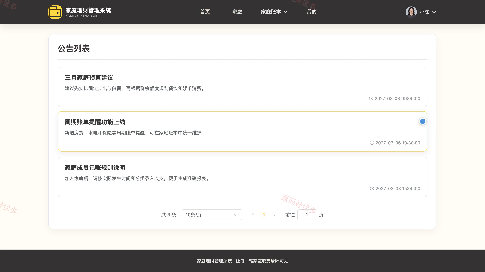
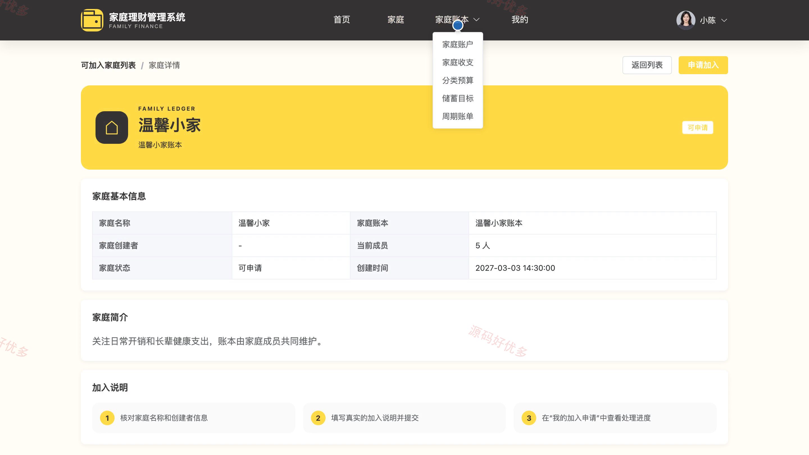
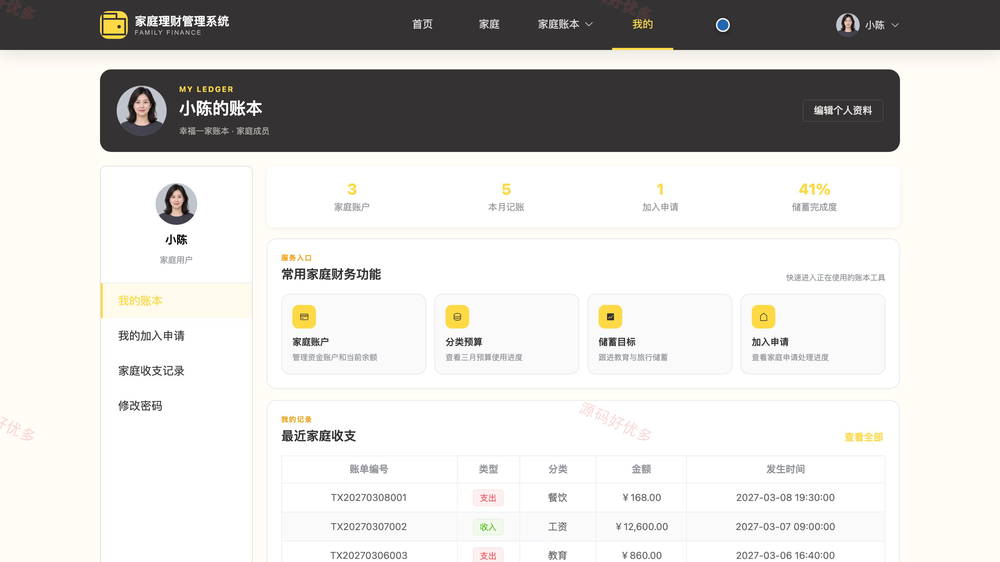
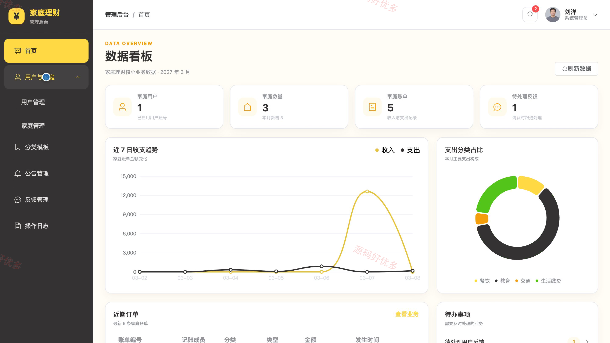
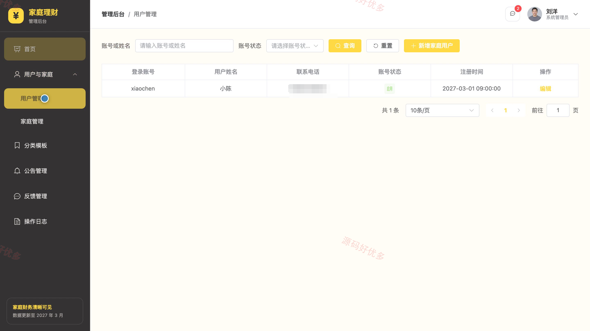
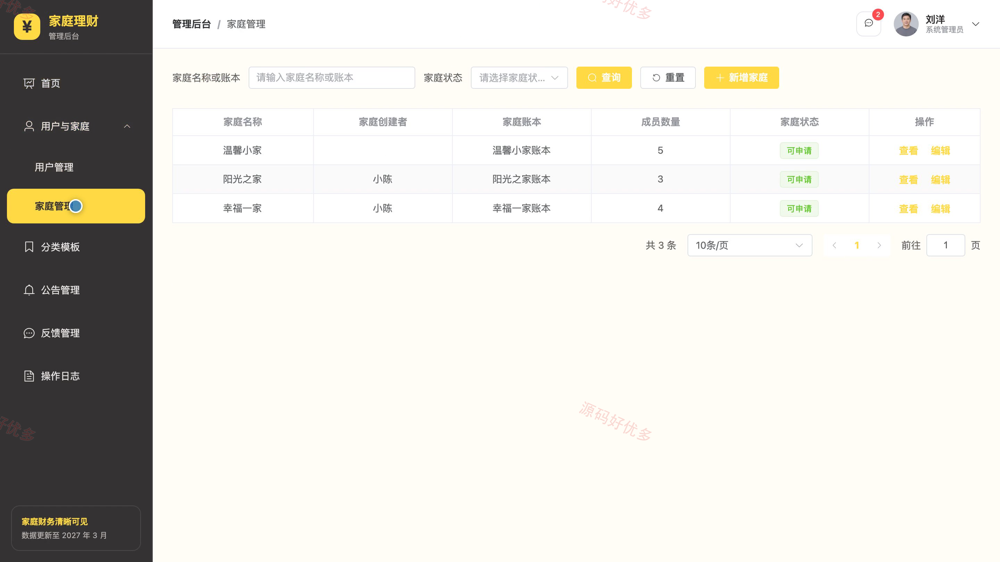
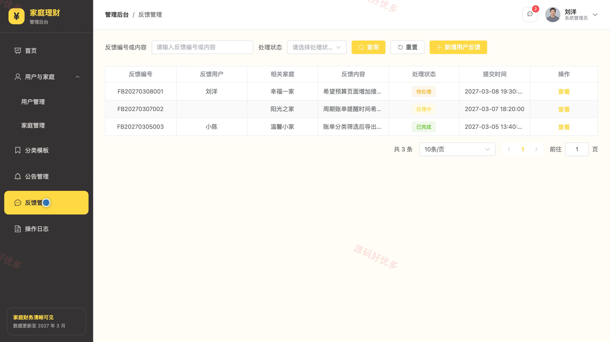

## 源码问题查看主页咨询

### 一、关键词
家庭理财、家庭账本、收支管理、预算管理、储蓄计划

### 二、作品包含
源码+数据库+万字设计文档+PPT+全套环境和工具资源+本地部署教程

### 三、项目技术
前端技术： Html、Css、Js、Vue3.4、Element-Plus
后端技术：Java、SpringBoot3.2.0、MyBatis-Plus

### 四、运行环境（以下版本亲测，其他版本兼容性请自行测试）
开发工具：IDEA/eclipse + VSCODE

数据库：MySQL5.7+（共16张表）

数据库管理工具：Navicat10以上版本

环境配置软件： JDK17 + Maven

前端Nodejs：16+

浏览器：谷歌浏览器

### 五、项目介绍
项目编号：bs098A

系统面向家庭用户和系统管理员，围绕家庭组建、成员加入、家庭账户、收支记录、分类预算、储蓄目标与周期账单形成完整的家庭理财流程，并支持平台公告、用户反馈和运营数据统一管理。

角色：家庭用户、系统管理员

家庭用户功能：账号注册与登录、家庭创建与加入申请、家庭账户管理、家庭收支记录、分类预算管理、储蓄目标跟踪、周期账单管理、个人账本与密码维护。

系统管理员功能：平台数据统计、家庭用户账号管理、家庭信息管理、收支分类模板管理、公告信息管理、首页轮播图管理、用户反馈处理、操作日志查看。

### 六、运行截图

